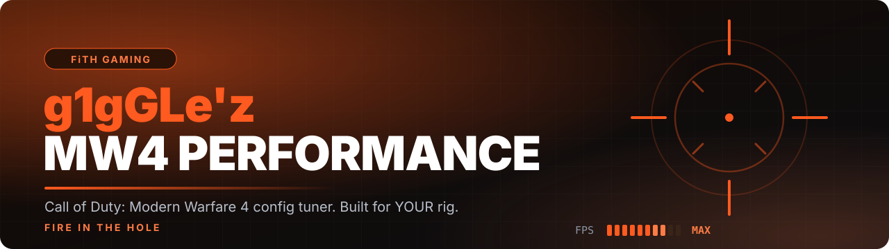
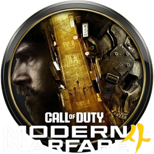
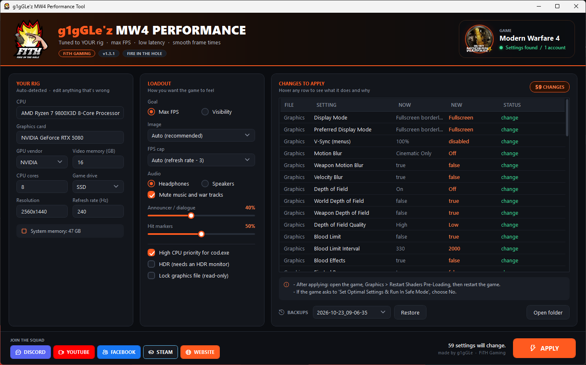
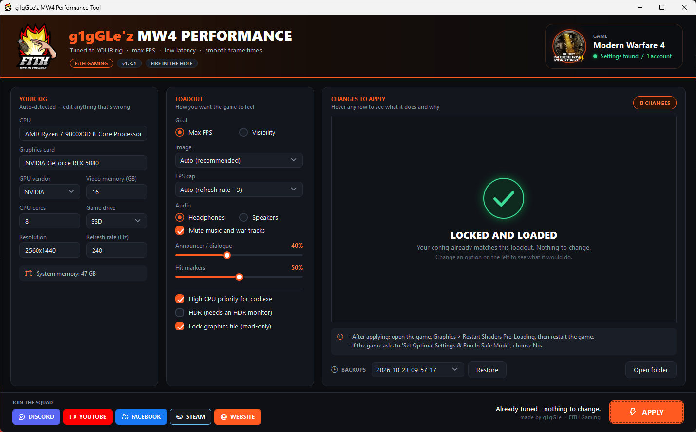

<div align="center">





### Max FPS. Low latency. Smooth frame times. Tuned to *your* rig, not someone else's.

<a href="https://github.com/FiTH-g1gGLe/COD-MW4-Config-Tool/releases/latest/download/MW4-Performance-Tool.zip"></a>
&nbsp;
<a href="https://discord.gg/Br7z7zBvFb"></a>

<a href="https://github.com/FiTH-g1gGLe/COD-MW4-Config-Tool/releases/latest"></a>


**[Features](#-features) · [Quick start](#-quick-start) · [What it changes](#-what-it-changes) · [Pro tips](#-pro-tips-outside-the-game) · [FAQ](#-faq) · [Changelog](CHANGELOG.md)**

</div>

---

## 🔥 What's new in v1.7

> **Field of view slider** that starts at your current FOV · **camera shake down to Minimal** · audio sliders keep your volumes ·
> **tick boxes** to choose exactly which changes apply · **HUD tuning**: square rotating minimap, magenta enemies and a HUD you can pull toward your crosshair.
> [Full changelog →](CHANGELOG.md)

---

## 📸 In action

<div align="center">



<sub><b>See every change before it happens.</b> Tick what you want, hover any row to learn what it does and why it suits your rig.</sub>

<br/><br/>



<sub><b>Locked and loaded.</b> Run it any time to check your config is still tuned.</sub>

</div>

---

## ⚡ Features

Most config packs copy one person's file onto every PC. That overwrites your monitor, GPU, audio device and driver
info with theirs, and ignores what your hardware can actually do.
**This tool reads your own config, detects your rig, and only changes the values that matter.**

<table>
<tr>
<td width="33%" valign="top">

#### 🎯 Built for your rig
CPU cores, GPU, video memory, resolution and refresh rate decide the settings, from a GTX 1650 to an RTX 5090.

</td>
<td width="33%" valign="top">

#### 🔍 See every change
Each setting shows what it is now and what it becomes. Hover for what it does, how much it matters, and **why**.

</td>
<td width="33%" valign="top">

#### ☑️ You choose
Tick boxes on every change. Keep what you like, apply the rest. Your choices are remembered.

</td>
</tr>
<tr>
<td valign="top">

#### 🗺️ A HUD that works
Square, rotating minimap (about 27% more map), magenta enemies that pop, and a slider to pull the HUD toward your crosshair.

</td>
<td valign="top">

#### 🎧 Hear them first
Headphone mode keeps 3D headphone audio and cuts music and speaker processing, so footsteps come through clean.

</td>
<td valign="top">

#### 👁️ Steady view
FOV slider from 90 to 120 and camera shake at the game's minimum, so your crosshair stays put.

</td>
</tr>
<tr>
<td valign="top">

#### 🛡️ One-click undo
Every apply makes a timestamped backup. Pick one and hit **Restore**.

</td>
<td valign="top">

#### ✅ Game-checked
Every value is checked against what the game allows. Anything invalid is skipped, never forced.

</td>
<td valign="top">

#### 🔄 Auto-updates
The tool checks for a new version when it opens. One click and it updates itself.

</td>
</tr>
</table>

---

## 🚀 Quick start

> [!IMPORTANT]
> Launch Call of Duty **once** first and get to the main menu, then close it. That creates the settings files the tool tunes.

| Step | |
|:---:|---|
| **1** | **[Download the latest release](https://github.com/FiTH-g1gGLe/COD-MW4-Config-Tool/releases/latest/download/MW4-Performance-Tool.zip)** and unzip it anywhere. |
| **2** | Close the game, then double-click **`Run MW4 Config Tool.bat`**. |
| **3** | **YOUR RIG** fills in by itself. Pick your **LOADOUT** (goal, audio, HUD position, FOV). Hover anything for a recommendation. |
| **4** | Untick anything in **CHANGES TO APPLY** you'd rather keep, then hit **APPLY**. |
| **5** | In game: **Graphics → Restart Shaders Pre-Loading**, then restart the game. |

> [!TIP]
> If the game asks to *"Set Optimal Settings & Run In Safe Mode"*, choose **No**. It would undo your tuning.

---

## 🧩 What it changes

### Smart settings, from your hardware

| Your hardware | Controls | Rule |
|---|---|---|
| 🧩 **CPU cores** | Render worker threads | physical cores − 1 (P-cores on Intel 12th–14th gen) |
| 🎮 **GPU vendor** | Latency | NVIDIA **Reflex** · AMD **Anti-Lag 2** · Intel **XeLL** |
| 🖼️ **GPU + VRAM + resolution** | Image | Native **SMAA + CAS sharpening**; **DLSS / FSR / XeSS** at 4K or under 8 GB VRAM (GTX cards get FSR) |
| 💾 **Video memory** | VRAM budget, textures | 12 GB+ → 0.9 · 8–11 GB → 0.8 · under 8 GB → 0.7 |
| 🖥️ **Refresh rate** | FPS cap | refresh − 3 to keep G-SYNC/FreeSync active (uncapped above 300 Hz) |

### Your loadout

| Option | Choices |
|---|---|
| **Goal** | **Max FPS** (lowest textures, 2× filtering) or **Visibility** (sharper textures and 8× filtering, scaled to your VRAM) |
| **Image** | Auto · Native + SMAA + sharpening · Upscaler |
| **FPS cap** | Auto · Uncapped · Custom |
| **Audio** | Headphones or Speakers · mute music · announcer and hit marker volume (start at your current levels) |
| **Field of view** | 90–120, starts at your current FOV · 100–105 recommended on 16:9 |
| **HUD position** | Screen edge → centre · 15% in by default, keeps yours if you've already moved it |
| **Extras** | HDR · High CPU priority for `cod.exe` · lock the graphics file read-only |

<details>
<summary><b>📋 The fixed baseline (click to expand)</b></summary>

<br/>

| Area | What it does |
|---|---|
| **Display** | Exclusive Fullscreen, 100% resolution scale, V-Sync off in game and menus, dynamic resolution off |
| **Blur** | Motion blur, weapon blur, velocity blur and depth of field off |
| **Clutter** | Blood, bullet casings, persistent damage and corpses off; bullet marks from your shots only |
| **Quality** | Lowest shadows, models, particles, shading, volumetrics, reflections, water, weather, terrain, tessellation |
| **Heavy features** | Ray tracing, frame generation and surface subdivision off |
| **Power saving** | Low-battery and menu power-saving options off |
| **Stability** | Shader pre-loading on, cloud settings sync off, hardware-change reset off |
| **Menus** | 120 FPS in menus, 30 FPS in the background, intro videos skipped |
| **View** | 1st person camera movement Minimal (25%) |
| **HUD** | Square, rotating minimap; magenta enemies if you're still on default red |

</details>

<details>
<summary><b>🚫 Deliberately left alone</b></summary>

<br/>

- **Sensitivity, keybinds and controller settings:** muscle memory is yours.
- **Colour filter:** those filters exist for colour-blind players; forcing one can make enemies *harder* to see.
- **ADS Field of View** (Affected / Independent) and **Enhanced FOV:** personal feel. Keep Enhanced FOV off for max FPS.
- **Your own enemy colour:** if you already picked one, the tool keeps it.

</details>

---

## 🎯 Pro tips (outside the game)

<table>
<tr>
<td width="50%" valign="top">

#### 🎨 OLED or wide-colour monitor?
If colours look washed out or too intense and players are hard to see in shade:
**NVIDIA App → System → Displays → Display Properties → Colour accuracy mode: Accurate.**
On AMD or other monitors, use the monitor's **sRGB** mode.

</td>
<td width="50%" valign="top">

#### 🖥️ G-SYNC / FreeSync
Make sure it's enabled **for your monitor**, not just globally (NVIDIA App → System → Displays).
With V-Sync **On** in the driver and Reflex in game, the tool's FPS cap keeps frame times smooth and tear-free.

</td>
</tr>
<tr>
<td valign="top">

#### ⚙️ Driver settings
Shader cache **Unlimited**, power management **Prefer maximum performance**.
Leave the game's HDR and Windows HDR **both off** unless you calibrate HDR properly.

</td>
<td valign="top">

#### 🚀 Launch options
Leave Steam launch options **empty**. Classic ones like `-high` never reach modern CoD;
the tool's **High CPU priority** option does that job properly.

</td>
</tr>
</table>

---

## 🛡️ Safe by design

- **Never replaces your files.** It patches values in place, so the game's own detection lines stay correct.
- **Backups every time** in `%LOCALAPPDATA%\MW4ConfigTool\backups`, restorable from the window.
- **Won't write while the game is running.**
- **Admin only when needed:** High CPU priority is the only thing that asks, and you can untick it.
- **Sliders start at your current values**, so nothing changes unless you move it.

---

## ❓ FAQ

<details>
<summary><b>It says it can't find the settings file.</b></summary>
<br/>Launch the game once, reach the main menu, close it, then run the tool again.
</details>

<details>
<summary><b>Colours look washed out / players are dark in shade.</b></summary>
<br/>That's usually the monitor, not the game. See <a href="#-pro-tips-outside-the-game">Pro tips</a>: set NVIDIA's Colour accuracy mode to Accurate, or use your monitor's sRGB mode.
</details>

<details>
<summary><b>Why is my FPS capped at 237 on a 240 Hz monitor?</b></summary>
<br/>A cap a few frames under your refresh rate keeps G-SYNC/FreeSync active and frame times even, which feels smoother than running uncapped. Pick <b>Uncapped</b> under FPS cap if you prefer.
</details>

<details>
<summary><b>The game reset some of my settings.</b></summary>
<br/>Run the tool again, or tick <b>Lock graphics file (read-only)</b> so the game can't change them.
</details>

<details>
<summary><b>How do I undo everything?</b></summary>
<br/>Pick the oldest backup in the <b>Backups</b> list and hit <b>Restore</b>.
</details>

<details>
<summary><b>Does it work with Battle.net?</b></summary>
<br/>It should: the tool finds the settings files wherever the game puts them. It's tested on Steam. If something looks off, <a href="https://github.com/FiTH-g1gGLe/COD-MW4-Config-Tool/issues/new/choose">open an issue</a>.
</details>

<details>
<summary><b>Will this get me banned?</b></summary>
<br/>It only edits the game's own settings files, the same ones the in-game menus write to. It doesn't touch game files, memory or anti-cheat. As with any tweak, use it at your own risk.
</details>

<details>
<summary><b>Command line</b></summary>

```powershell
# Apply the recommended settings with no window
powershell -ExecutionPolicy Bypass -File .\MW4-Config-Tool.ps1 -Silent

# Show what would change without writing anything
powershell -ExecutionPolicy Bypass -File .\MW4-Config-Tool.ps1 -Silent -DryRun

# Skip the update check
powershell -ExecutionPolicy Bypass -File .\MW4-Config-Tool.ps1 -NoUpdateCheck
```

</details>

---

## 🔗 Join the squad

<div align="center">

<a href="https://discord.gg/Br7z7zBvFb"></a>
<a href="https://www.youtube.com/user/FiTHGAMINGOFFICIAL"></a>
<a href="https://www.facebook.com/FiTHGAMINGOFFICIAL/"></a>
<a href="https://steamcommunity.com/groups/FiTHOFFICIAL"></a>
<a href="http://fithgaming.co.uk/"></a>

**Be part of something ep1c.**

Found a bug or got an idea? **[Open an issue](https://github.com/FiTH-g1gGLe/COD-MW4-Config-Tool/issues/new/choose)** or shout in the Discord.

</div>

---

## 🙏 Credits

The "turn it all off" baseline follows the pattern of
[FR33THY's Call of Duty configs](https://github.com/FR33THYFR33THY/Github-Game-Configs) for Black Ops 6 and 7,
which use the same settings format.

<div align="center">
<br/>
<sub>Made by <b>g1gGLe</b> · <b>FiTH Gaming</b> · Fire in the Hole 🔥</sub>
<br/>
<sub>Unofficial fan-made tool. Not affiliated with or endorsed by Activision. Call of Duty and Modern Warfare are trademarks of Activision Publishing, Inc.</sub>
</div>
